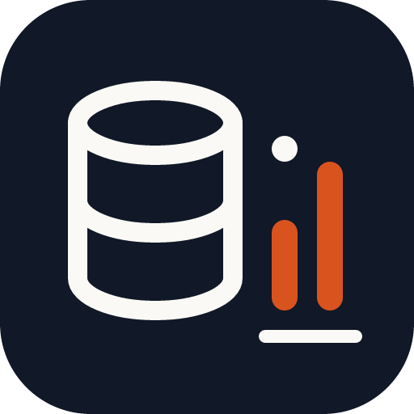

LIVE DATA. GROUNDED ANSWERS.

# Your database. A clearer view.

Give Claude and Codex a live view of your Astra DB. Inspect real schemas, explore documents, and search by meaning before writing the next line of code.

[Get started](install.md){ .md-button .md-button--primary }
[Explore the workflows](workflows.md){ .md-button }

Claude Code · Codex · Claude Desktop · Node.js 20+

### Explore with context

See keyspaces, collections, tables, and the shape of real data before making a change.

### Search by meaning

Use vector and hybrid search, then inspect the documents behind each result.

### Make reviewable changes

Read-only mode and confirmation for destructive operations keep intent visible.

## Built for the agent you use

Claude Code and Codex share the same project capabilities through native plugin packages. Install from the JEStats repository marketplace, restart your agent, and begin with a small, inspectable task.

[Choose your installation](install.md) · [Read the source](https://github.com/jestatsio/astra-db-plugin) · [View releases](https://github.com/jestatsio/astra-db-plugin/releases)

## Availability, without ambiguity

The repository marketplaces and release packages are community distributions by JEStats. Compatibility and a successful installation do not imply official directory approval or endorsement. See [reference and support](reference.md) for current distribution evidence, privacy, and troubleshooting.
